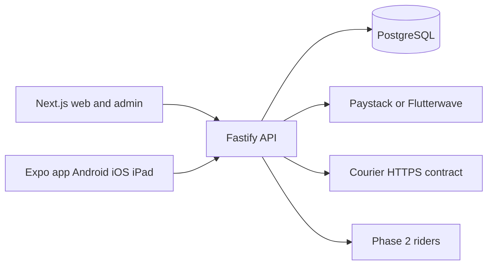

# Architecture

The web app proxies `/backend` to the API so the browser stays on one origin. The phone app calls the API directly with a bearer token kept in secure storage. Both clients send the same JSON.

Money maths lives in `@ninted/domain`, which has no database. The API loads commercial rows, calls that package, and writes the returned snapshot onto the order. Later edits to settings do not update old orders.

## Payment

1. Checkout creates `PENDING_PAYMENT` and reserves stock.
2. `POST /payments/initiate` creates an `INITIATED` payment and asks the provider for an authorization URL.
3. The provider redirects to `/payments/callback`.
4. The API calls the provider verify endpoint. The redirect query string is not trusted.
5. A signed webhook does the same verify step. Settlement is idempotent on the payment row.
6. Ledger lines are written only inside that settlement. Seller cash is not sent. Finance later records a payout against a bank reference.

If the secret key is missing, initiate returns `503 PAYMENT_UNCONFIGURED` and the order stays unpaid.

This ledger hold is not Paystack split payment and it is not escrow. Automatic transfers stay off unless `PAYSTACK_TRANSFERS_ENABLED` is set later, and even then a transfer must not be described as escrow unless counsel and the provider say so. The current payout screen records a transfer the finance admin already made.

## Delivery

Quotes can come from:

- seller-arranged handover
- the owner’s `DELIVERY_RATE_CARD`
- an enabled courier that implements `docs/COURIERS.md`
- a Ninted rider, only when phase 2 is on, a rate card exists, and an approved rider is on duty in the pickup state

Booking a courier happens after payment, and only if that courier’s API accepts the booking. If it fails, the shipment stays unbooked and the failure is stored. Nothing advances a parcel to “delivered” by itself.

## Phase 2

Rider applications, approval, job accept, pickup PIN, drop-off PIN, GPS pings and delivery photos are implemented. `PHASE2_LOGISTICS` defaults to false, so the routes answer 404 until the owner turns the network on. External couriers stay available beside riders.

## Staff

Roles: support, moderator, finance admin, logistics admin, super admin. Permissions are listed in `packages/domain/src/access.ts`. Staff routes also require TOTP. Secrets such as NIN material, bank numbers and courier keys are encrypted with AES-GCM. Only the last four digits are shown back. Card numbers are never stored.
