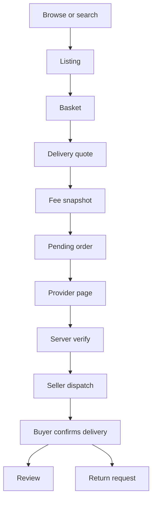
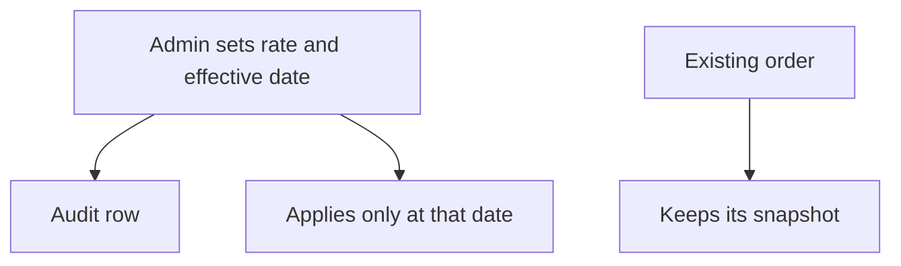

# Screens and journeys

## Web

Home, browse, listing, seller profile, basket, checkout, payment callback, orders, order detail, favourites, inbox, account, sell desk, new listing, seller orders, earnings, admin home, commercial settings, listing moderation, orders and returns, payouts, policies.

## Phone

Home, listing, sign in / register, basket, orders, account. Android, iOS and iPad share this screen set. Rider duty is on the API and can be added to this same app when phase 2 is enabled.

## Buyer

## Owner changes a fee

## Seller

Register or add a seller profile, submit last-four NIN, wait for verification, publish, answer offers and messages, dispatch paid orders, read the ledger, request a payout. The payout stays pending until finance records a bank reference.
